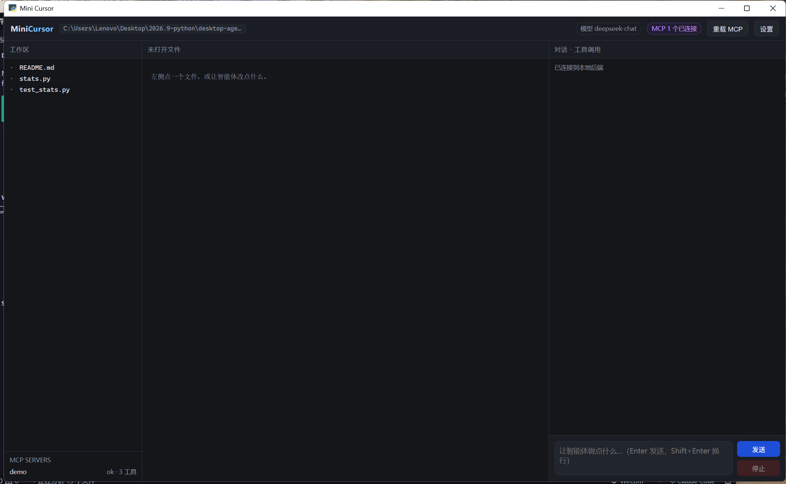
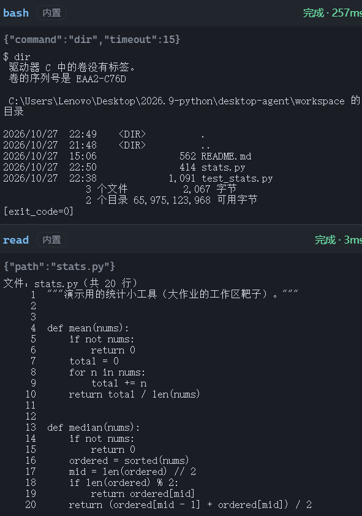
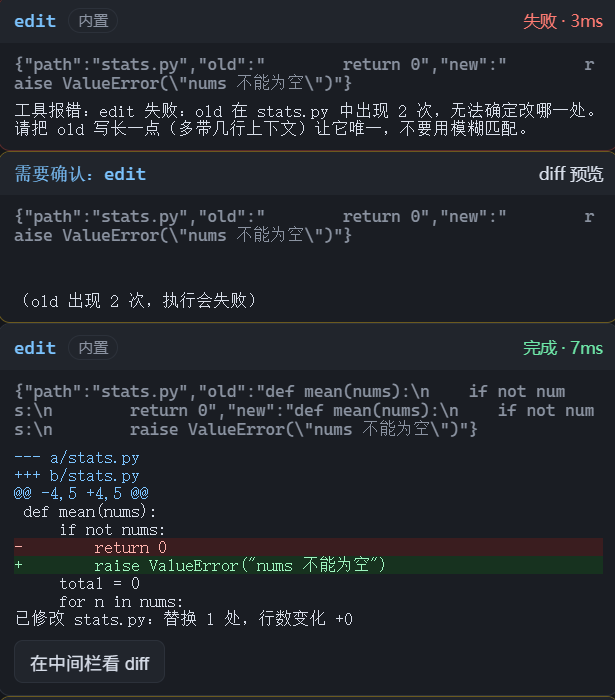
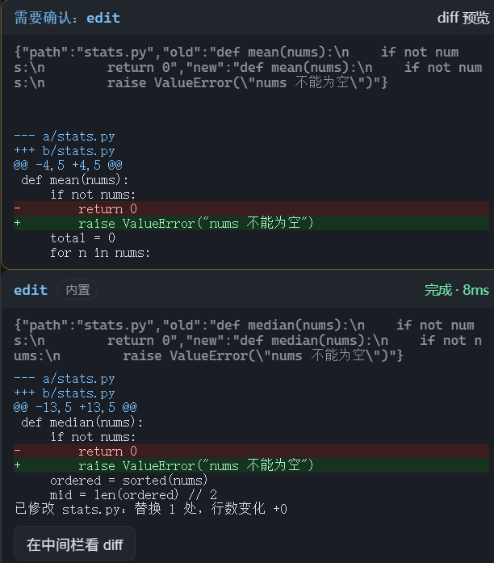
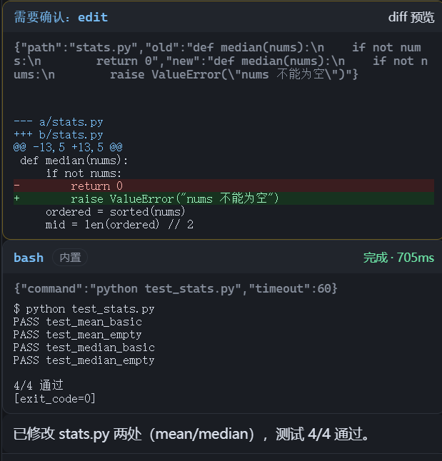

# Mini Cursor · 桌面编程智能体

一个能**双击打开**的桌面窗口，里面跑着一个会读代码、改代码、跑测试的智能体。
四个工具（`read` / `write` / `edit` / `bash`）+ 真接上的 MCP server。



## 实际跑一次「修 bug」任务的完整轨迹

第一步先 `bash dir` 摸清工作区、`read` 读目标文件：



第一次 `edit` 用了太短的 `old`（`return 0` 出现 2 次），**工具直接拒绝、如实报错**；
确认卡片还会提前标注「执行会失败」。模型补上下文后第二次成功，diff 一目了然：



写操作先给人确认（diff 预览），确认后才落盘——这是可关掉的闸门：



最后跑测试验证，4/4 通过。**说改了就是真改了**，测试结果是工具跑出来的：



---

## 三步启动

```bash
# 1) 装依赖
python -m venv .venv
.venv\Scripts\activate          # macOS/Linux: source .venv/bin/activate
pip install -r requirements.txt

# 2) 配 Key（二选一）
cp .env.example .env            # 然后填 OPENAI_API_KEY
#   或者：启动后在窗口右上角「设置」里填，会自动存到 ~/.desktop-agent/settings.json

# 3) 双击打开
python app.py
```

出来的是一个带标题栏的独立窗口（`pywebview`），不是浏览器里的 localhost 页面。

**已经打包好的 exe（不用装 Python）：**
`dist/MiniCursor_1.0.0_Windows_x64.zip` 解压 → 双击 `MiniCursor.exe`。
想要「下一步下一步」的安装程序：用 Inno Setup 编译 `installer/install.iss`（步骤见 `docs/build.md`）。
只想起后端（比如 `curl -N` 看事件流）：`python app.py --no-window`

**不配 Key 也能看完整链路**：

```bash
python scripts/selftest.py     # 工具单测 + MCP 往返 + 一次完整 ReAct 轨迹
python -m agent.cli "读一下工作区里有什么文件" --mock
```

---

## 界面三块

| 栏 | 内容 |
|---|---|
| 左 | 工作区文件树（点击在中间打开）+ MCP server 连接状态 |
| 中 | 文件内容（带行号）；工具改完文件后可以点「在中间栏看 diff」看增删行 |
| 右 | 对话流 + 每一次工具调用的卡片：工具名、参数、耗时、成功/失败、diff、输出 |

三件事是硬要求，都做了：

- **看得见**：读了哪个文件、改了什么（diff）、命令输出，全在右栏卡片里
- **可中断**：右栏「停止」按钮，点了循环真的停（后端 `asyncio.Event`，下一步之前退出）
- **失败标红**：工具报错卡片变红并原样回灌给模型 —— 错误是它下一步的线索

---

## 四个工具

| 工具 | 语义 | 容易做错的地方（这里怎么处理） |
|---|---|---|
| `read` | `path, offset, limit`；文本按行带行号，图片返回多模态内容块 | 大文件分页并提示「还有 N 行」；图片走 `image_url`，不塞进 text |
| `write` | `path, content`；自动建父目录，临时文件 + `os.replace` 原子写 | 覆盖时告诉模型「原 X 行 → 现 Y 行」 |
| `edit` | `path, old, new`；精确替换 + 唯一性检查 | **出现 0 次或 ≥2 次直接报错，不许猜**；不做整文件重写 |
| `bash` | `command, timeout`；stdout + stderr + exit_code | 一定有超时（默认 30s，上限 120s），输出一定截断，非 0 也正常返回 |

为什么只要四个：`bash` 把"列目录 / 跑测试 / git / 装依赖"全压成一个工具 —— 工具越少，模型选错的概率越低。

---

## MCP

`mcp.json` 里配 server，界面上「重载 MCP」热加载，左下角显示每个 server 的在线状态和工具数。

```json
{ "mcpServers": { "demo": { "command": "python", "args": ["examples/mcp_demo_server.py"] } } }
```

仓库自带一个**纯标准库**的示例 server（`examples/mcp_demo_server.py`，约 120 行），
暴露 `get_weather` / `now` / `add` 三个工具。它证明了一件事：MCP 就是两个进程用 JSON 互相问
"你有什么""我要这个""给你"。

客户端在 `agent/mcp.py`：`initialize → notifications/initialized → tools/list → tools/call`，
工具名映射成 `mcp_<server>_<tool>` 后和内置工具一起进模型上下文（卡片上带 `MCP` 标签）。

---

## 五道护栏

| 风险 | 护栏 | 位置 |
|---|---|---|
| 死循环 / 烧钱 | `max_steps`（默认 12）+ 整体超时 + 上下文预算 | `agent/loop.py` |
| 上下文爆炸 | 工具返回值截断、超预算自动压缩旧观察、`read` 分页 | `agent/tools.py` / `loop.py` |
| 越权 | `resolve()` + 前缀白名单，越界直接拒 | `agent/tools.py:_resolve` |
| 破坏性命令 | `bash` 危险命令黑名单 + 强制超时 | `agent/tools.py:bash` |
| 改错东西 | 写操作先给 diff 预览，确认后才执行（可在设置里关） | `agent/loop.py:_preview` |

再加一条：连续 3 次相同调用会被检测到并提醒模型换路。

---

## 目录

```
desktop-agent/
├── app.py                  桌面入口（pywebview）／--no-window／--cli
├── agent/                  循环 + 四个工具（能脱离界面单独跑）
│   ├── loop.py             ReAct 循环与三道护栏
│   ├── tools.py            read / write / edit / bash
│   ├── llm.py              OpenAI 兼容流式客户端
│   ├── mcp.py              MCP stdio 客户端
│   ├── prompts.py / mock.py / cli.py / config.py
├── server/app.py           FastAPI + WebSocket 事件流
├── ui/                     index.html / app.js / style.css
├── examples/mcp_demo_server.py
├── scripts/selftest.py     自检（生成 docs/trace.md）
├── workspace/              智能体的沙箱（stats.py 里留了个 bug 给它修）
└── docs/                   trace.md · build.md
```

## 事件流协议（关掉前端也能测）

```bash
python app.py --no-window
wscat -c ws://127.0.0.1:8765/ws
> {"type":"chat","text":"让 mean 对空列表抛 ValueError"}
< {"type":"hello",...} {"type":"step",...} {"type":"tool_call",...}
< {"type":"tool_result","ok":true,...} {"type":"confirm_request","diff":"--- a/..."}
> {"type":"confirm","accept":true}
< {"type":"token","text":"..."} {"type":"done","text":"..."}
> {"type":"stop"}                       # 中断
```
